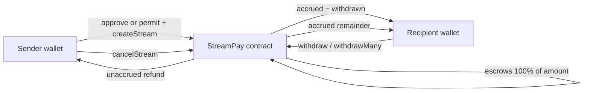
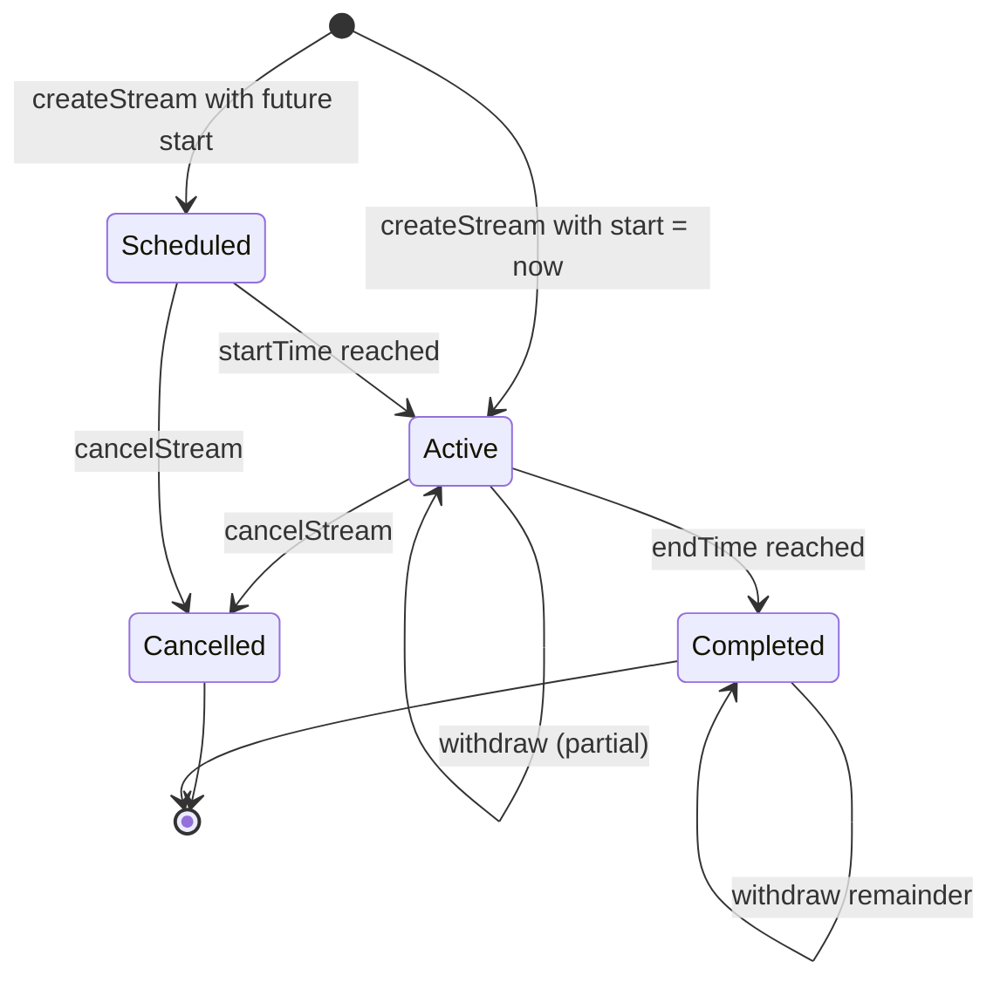

# StreamPay

> **Pay by the second, not by the invoice.**
>
> Non-custodial, fully-funded tUSD8 payment streams on **QDay Aevum Testnet**.

StreamPay turns a lump-sum payment into a live balance. A sender escrows the full
amount once; the recipient watches it unlock every second and can withdraw
whenever they want. Senders can cancel at any time to recover whatever has not
accrued yet. There is no custodian, no account system, no per-second transaction
and no fee.

Built for **Aevum Builder Challenge #1**.

<p>
  
  
  
  
  
  
</p>

> **Testnet only.** tUSD8 and tQDAY are free test assets with no monetary value
> and no expectation of value. The contract is unaudited. Do not use it with
> assets you care about.

---

## Table of contents

- [Why StreamPay](#why-streampay)
- [What you can do](#what-you-can-do)
- [How it works](#how-it-works)
  - [The accrual model](#the-accrual-model)
  - [Lifecycle](#lifecycle)
  - [Cancellation](#cancellation)
  - [Permit-based creation](#permit-based-creation)
- [Screens](#screens)
- [Network and contracts](#network-and-contracts)
- [Repository layout](#repository-layout)
- [Quick start](#quick-start)
  - [Local demo (no testnet funds)](#local-demo-no-testnet-funds)
  - [Run against Aevum](#run-against-aevum)
- [Contract API](#contract-api)
- [Frontend architecture](#frontend-architecture)
- [Testing](#testing)
- [Deployment](#deployment)
- [Security](#security)
- [Design](#design)
- [FAQ](#faq)
- [Roadmap](#roadmap)
- [Docs](#docs)
- [License](#license)

---

## Why StreamPay

Most crypto payments are still invoices in disguise: someone sends a lump sum,
and the recipient hopes it arrives. Salaries, grants, retainers and subscriptions
all represent work that happens continuously, but the money moves in batches.

Existing "streaming" products often solve this by adding custody, keepers,
per-second transactions, or an admin who can freeze funds. StreamPay takes the
opposite approach:

| | StreamPay |
|---|---|
| Custody | None — the contract escrows, the recipient withdraws directly |
| Funding | 100% up front, so every obligation is collateralized |
| Transfers | Only when someone withdraws or cancels |
| Accrual | Linear, computed from block timestamps on every read |
| Admin | None — no owner, pause, fee, proxy or upgrade |
| Identity | A wallet; no accounts, passwords or email |
| Fees | Zero protocol fees; only network gas |

The result is a payment primitive that behaves like a bank balance that grows in
real time, while keeping the on-chain surface small enough to audit in one
sitting.

## What you can do

### As a sender

- **Open any number of streams** to any EVM address on Aevum, including addresses
  that have never used the app.
- **Choose the schedule** in seconds, minutes, hours or days, starting now or at
  a future timestamp.
- **Fund once.** The full amount leaves your wallet at creation; there are no
  recurring approvals and no per-second gas.
- **Monitor every stream** from one dashboard: rate, progress, withdrawn amount,
  remaining balance, status.
- **Cancel an active stream** and recover the unaccrued remainder immediately.
- **Keep an on-chain receipt** for every stream: transaction hash, parties,
  schedule, withdrawals, and a printable summary.

### As a recipient

- **See value accrue every second** against the chain clock, not a server clock.
- **Withdraw whenever you want**, in any amount up to the accrued balance.
- **Claim everything at once** with a single batched transaction across up to 50
  streams.
- **Cancel a stream yourself** if you want to stop accrual and settle early; you
  keep what has accrued and the sender is refunded the rest.
- **Verify everything independently** on the QDay explorer.

### As a judge

- One command spins up a local chain with a mock token and five seeded streams.
- A gated demo connector lets you create, withdraw and cancel without installing
  a wallet extension.
- 61 Foundry tests and 29 frontend tests run offline.

## How it works



The contract is the only source of truth. The frontend reads it, animates an
estimate between blocks, and reconciles after every transaction.

### The accrual model

Each stream stores `amount`, `startTime`, `endTime`, `withdrawn`, and
`cancelledAt`. Nothing ticks on-chain. Every read computes:

```
duration    = endTime − startTime
elapsed(t)  = clamp(t − startTime, 0, duration)
accrued(t)  = amount × elapsed(t) / duration
withdrawable(t) = max(accrued(t) − withdrawn, 0)
```

with `t` frozen at `cancelledAt` once a stream is cancelled.

Properties:

- **Before the start:** nothing accrues.
- **At the end:** `accrued == amount`.
- **Rounding:** integer division rounds down, so the recipient can never
  withdraw more than the schedule allows. The final dust settles at completion.
- **Monotonic:** accrual never decreases, and cancellation never rewinds it.
- **Solvent:** the contract balance always covers every outstanding obligation.

### Lifecycle



- **Scheduled** streams are fully funded but accrue nothing until `startTime`.
- **Active** streams accrue linearly and accept partial withdrawals.
- **Completed** streams have accrued the full amount and cannot be cancelled.
- **Cancelled** streams are frozen permanently at `cancelledAt`.

### Cancellation

Either party may cancel `Active` or `Scheduled` streams. In one transaction:

1. `cancelledAt = block.timestamp` (accrual stops).
2. The recipient receives `accrued(cancelledAt) − withdrawn`, if any.
3. The sender receives `amount − accrued(cancelledAt)`, the unaccrued remainder.
4. The stream is marked `Cancelled` and emits `StreamCancelled`.

Nothing is left pending. A recipient cannot block a sender's refund by refusing
to withdraw, and a sender cannot cancel without paying the recipient what has
already accrued.

### Permit-based creation

tUSD8 implements EIP-2612. StreamPay offers two approval paths:

| Path | Wallet prompts | On-chain transactions |
|---|---|---|
| **Sign & create** | 1 typed-data signature + 1 confirmation | 1 (`createStreamWithPermit`) |
| **Approve first** | 2 confirmations | 2 (`approve`, then `createStream`) |

The permit is **best-effort**. `createStreamWithPermit` wraps `permit` in
`try/catch`, then always runs the normal allowance check and balance-delta
verification. If the permit was front-run, expired, or unsupported, the call
still succeeds only when an allowance exists and the tokens actually arrive. A
failed permit can never create an unfunded stream.

The "Approve first" path approves the exact amount, so no residual allowance is
left behind after creation.

## Screens

| Route | What it shows |
|---|---|
| `/` | Landing page with a live simulated hero, how it works, mechanics, security, network, FAQ |
| `/dashboard` | Receiving and sending tabs, totals, per-stream live balances, withdraw-all |
| `/create` | Stream builder with validation, presets, live rate preview, review dialog, permit/approve choice |
| `/streams/[id]` | Live detail: progress, parties, rate, withdrawals, history, receipt, cancel/withdraw |
| `/docs` | Protocol mechanics, contract surface, network details, local setup |

The shared clock lives in `web/lib/providers/`. It reads the latest block
timestamp once, estimates the offset from the browser clock, then ticks locally
every second. Every number on screen uses that clock, so the dashboard and the
detail page always agree.

## Network and contracts

| | |
|---|---|
| Network | QDay Aevum Testnet |
| Chain ID | `44005` (`0xABE5`) |
| RPC | `https://rpc-test.qday.info` |
| WebSocket | `wss://rpc-test.qday.info` |
| Explorer | https://explorer-test.qday.info |
| Faucet | https://faucet.qday.info/en |
| Gas token | tQDAY (18 decimals) |
| Payment token | tUSD8 `0x456569838f1d43009A91ebA4263147Afd7233483` (6 decimals) |
| Multicall3 | `0xcA11bde05977b3631167028862bE2a173976CA11` |
| StreamPay | see [`deployments/aevum.json`](./deployments/aevum.json) |

tUSD8 also implements EIP-2612 with EIP-712 domain `("tUSD8", "2", 44005)`. The
domain separator was verified on-chain before the permit flow was shipped.

> Always confirm addresses in the deployment record and on the explorer. Never
> send funds to an address copied from a chat message.

## Repository layout

```
.
├── contracts/
│   ├── src/
│   │   ├── StreamPay.sol          # the entire protocol
│   │   └── mocks/                 # mock tUSD8 + adversarial tokens (tests only)
│   ├── test/
│   │   ├── StreamPay.t.sol        # unit + fuzz tests
│   │   ├── StreamPayInvariant.t.sol
│   │   └── mocks/                 # handler + reentrant/fee tokens
│   ├── script/
│   │   ├── Deploy.s.sol           # Aevum deployment with a chain guard
│   │   └── DeployLocal.s.sol      # Anvil fixture with seeded streams
│   ├── lib/                       # vendored forge-std and OpenZeppelin
│   └── foundry.toml
├── web/
│   ├── app/                       # App Router routes
│   ├── components/
│   │   ├── app/                   # product UI
│   │   ├── brand/                 # amount, live dot, empty states, logo
│   │   └── ui/                    # shadcn-style primitives
│   ├── lib/
│   │   ├── abi/                   # generated StreamPay + ERC-20 ABIs
│   │   ├── deployments/           # checked-in deployment records
│   │   ├── hooks/                 # reads, writes, events
│   │   ├── providers/             # wagmi, query, clock, toast
│   │   ├── accrual.ts             # accrual + status math (tested)
│   │   ├── format.ts              # money/number formatting (tested)
│   │   ├── config.ts              # chain/token/deployment resolution
│   │   └── wagmi.ts               # chain, transports, connectors
│   └── test/                      # Vitest
├── deployments/                   # written by the deploy scripts
├── docs/                          # extra notes
├── scripts/sync-abi.sh            # copy the ABI from Foundry artifacts
├── ARCHITECTURE.md
├── SECURITY.md
├── DEPLOYMENT.md
├── DEMO.md
├── SUBMISSION.md
├── Makefile
└── LICENSE
```

## Quick start

### Local demo (no testnet funds)

Requirements: Node 22+, pnpm 9 (`corepack enable`), Foundry, and a browser.

```bash
# 1. Chain with the Aevum chain id (44005) and unlocked dev accounts
anvil --chain-id 44005

# 2. Mock tUSD8, StreamPay, and five seeded streams
cd contracts
forge script script/DeployLocal.s.sol:DeployLocal \
  --rpc-url http://127.0.0.1:8545 --broadcast

# 3. Web app
cd ../web
cp .env.example .env.local
# set:
#   NEXT_PUBLIC_DEPLOYMENT=local
#   NEXT_PUBLIC_DEMO_WALLET=1
pnpm install
pnpm dev
```

Open http://localhost:3000. The demo connector signs as Anvil account #0, which
receives three of the seeded streams and sends two.

Seeded fixture:

| Account | Address | Role |
|---|---|---|
| #0 | `0xf39Fd6e51aad88F6F4ce6aB8827279cffFb92266` | demo recipient + sender |
| #1 | `0x70997970C51812dc3A010C7d01b50e0d17dc79C8` | sender / recipient |
| #2 | `0x3C44CdDdB6a900fa2b585dd299e03d12FA4293BC` | sender |

Each account starts with 1,000,000 mock tUSD8. Full walkthrough: [`DEMO.md`](./DEMO.md).

Useful shortcuts:

```bash
make anvil          # local chain
make deploy-local   # fixture
make dev            # web app
make test           # contracts + frontend
```

### Run against Aevum

```bash
cd web
cp .env.example .env.local
# leave NEXT_PUBLIC_DEPLOYMENT unset (or "aevum")
# optionally set NEXT_PUBLIC_STREAMPAY_ADDRESS if the record is not filled in
pnpm install && pnpm dev
```

Connect a wallet, switch to chain 44005 when prompted, and get tUSD8 from the
faucet. No API keys or backend are required.

## Contract API

`contracts/src/StreamPay.sol` · Solidity 0.8.24 · EVM `paris` · optimizer 200

### Writes

```solidity
function createStream(
    address recipient,
    uint256 amount,
    uint64 startTime,   // 0 = now
    uint64 endTime
) external returns (uint256 streamId);

function createStreamWithPermit(
    address recipient,
    uint256 amount,
    uint64 startTime,
    uint64 endTime,
    uint256 deadline,
    uint8 v,
    bytes32 r,
    bytes32 s
) external returns (uint256 streamId);

function withdraw(uint256 streamId) external returns (uint256 amount);

function withdrawMany(uint256[] calldata streamIds)
    external returns (uint256 total);

function cancelStream(uint256 streamId) external;
```

### Reads

```solidity
function getStream(uint256 streamId) external view returns (StreamView);
function accruedOf(uint256 streamId) external view returns (uint256);
function withdrawableOf(uint256 streamId) external view returns (uint256);

function streamCount() external view returns (uint256);
function senderStreamCount(address account) external view returns (uint256);
function recipientStreamCount(address account) external view returns (uint256);

function getSenderStreams(address account, uint256 offset, uint256 limit)
    external view returns (StreamView[] memory);
function getRecipientStreams(address account, uint256 offset, uint256 limit)
    external view returns (StreamView[] memory);

function token() external view returns (IERC20);
function tokenDecimals() external view returns (uint8);
```

### Events

```solidity
event StreamCreated(
    uint256 indexed streamId,
    address indexed sender,
    address indexed recipient,
    uint256 amount,
    uint64 startTime,
    uint64 endTime
);

event Withdrawal(
    uint256 indexed streamId,
    address indexed recipient,
    uint256 amount
);

event StreamCancelled(
    uint256 indexed streamId,
    address indexed cancelledBy,
    uint256 senderRefund,
    uint256 recipientWithdrawable,
    uint64 cancelledAt
);
```

### Limits and errors

- `MAX_BATCH = 50` streams per `withdrawMany`.
- `MAX_PAGE = 50` per account page.
- Amounts fit in `uint128`; timestamps fit in `uint64`.
- Token decimals must be ≤ 18.
- Errors are typed and descriptive: `InsufficientAllowance`, `UnexpectedTransferAmount`,
  `SelfStream`, `InvalidDuration`, `NotRecipient`, `NotStreamParty`,
  `StreamAlreadyEnded`, `StreamAlreadyCancelled`, `NothingToWithdraw`,
  `BatchTooLarge`, `InvalidPage`, and others.

## Frontend architecture

- **Reads** use wagmi + TanStack Query, keyed by chain, contract address and
  account. Dashboards paginate 50 at a time and refresh every 7 seconds; a detail
  page refreshes every 5 seconds.
- **Writes** run through shared transaction lifecycles: simulate → sign → pending
  → receipt → invalidate → success. Failures map to human-readable messages,
  including wallet rejection and insufficient funds.
- **Approvals** support both permit and approve-first, with automatic fallback if
  typed-data signing is unavailable.
- **Events** provide per-stream history and receipts, scoped from the deployment
  block so the app never scans the whole chain.
- **Network handling** detects the wrong chain and offers a user-initiated switch
  or add-network flow. Nothing switches silently.
- **Estimates vs. finalized:** live numbers are labeled as estimates; balances
  shown in receipts come from re-read contract state after confirmation.

Key files:

| File | Responsibility |
|---|---|
| `web/lib/config.ts` | Chain, token, RPC and deployment resolution |
| `web/lib/chain.ts` | viem chain definition for Aevum |
| `web/lib/wagmi.ts` | Transports, injected connector, gated demo connector |
| `web/lib/accrual.ts` | Mirrors the contract's accrual math for the UI |
| `web/lib/hooks/use-streams.ts` | Stream, count, balance and allowance reads |
| `web/lib/hooks/use-create-stream.ts` | Permit + approve creation flow |
| `web/lib/hooks/use-withdraw.ts` | Single and batch withdrawals |
| `web/lib/hooks/use-cancel-stream.ts` | Cancellation and settlement |
| `web/lib/providers/clock-provider.tsx` | The shared chain-corrected clock |

## Testing

```bash
# Contracts — 61 tests, including fuzz and stateful invariants
cd contracts && forge test

# Frontend — 29 unit tests for accrual and formatting
cd web && pnpm test:run

# Static checks and production build
cd web && pnpm typecheck && pnpm lint && pnpm build
```

The invariant suite drives random creates, withdrawals, cancellations and time
jumps through a handler, then checks:

1. `balanceOf(StreamPay)` equals the sum of all outstanding obligations.
2. Every stream satisfies `withdrawn ≤ accrued ≤ amount`.
3. Withdrawals never exceed accrued value.

Other notable tests cover fee-on-transfer rejection, permit front-running,
exact-amount approvals, reentrancy, batch limits, duplicate ids, pagination, and
cancellation conservation.

## Deployment

Short version:

```bash
cd contracts
PRIVATE_KEY=0x... forge script script/Deploy.s.sol:Deploy \
  --rpc-url https://rpc-test.qday.info --broadcast
```

The script:

1. Refuses to run unless `block.chainid == 44005`.
2. Verifies the token's decimals.
3. Deploys `StreamPay(token)`.
4. Writes `deployments/aevum.json` and `web/lib/deployments/aevum.json`.

Verify on the explorer with the Blockscout flow documented by QDay:

```bash
forge verify-contract \
  --chain-id 44005 \
  --verifier blockscout \
  --verifier-url https://explorer-test.qday.info/api \
  --constructor-args $(cast abi-encode "constructor(address)" 0x456569838f1d43009A91ebA4263147Afd7233483) \
  <ADDRESS> src/StreamPay.sol:StreamPay
```

Then host `web/` on Vercel (root directory `web`, Node 22, `pnpm build`) with
`NEXT_PUBLIC_APP_URL` set. Never set the local demo flags in production.

Full instructions, including the faucet, environment variables and smoke tests:
[`DEPLOYMENT.md`](./DEPLOYMENT.md).

## Security

- No owner, admin, pause, proxy, fee or rescue function.
- One immutable token; a new version means a new contract.
- `ReentrancyGuard` on every state-changing entry point.
- `SafeERC20` for non-standard tokens; fee-on-transfer deposits are rejected by
  measuring the actual received amount.
- Permit is best-effort and always followed by allowance + transfer checks.
- Exact-amount approvals leave no residual allowance.
- Either party can cancel; both sides settle atomically.
- Completed streams cannot be cancelled; cancelled streams cannot accrue.

The full threat model, invariants and known limitations are in
[`SECURITY.md`](./SECURITY.md). The deployment is unaudited and testnet-only.

## Design

The UI uses a "night ledger" system: warm near-black surfaces, bone text, one
electric lime signal color, mint for incoming value, amber for scheduled streams,
and coral only for destructive actions. Money and addresses always use tabular
monospace. Motion is subtle and respects `prefers-reduced-motion`.

The rules live in [`brand.md`](./brand.md) and are applied through Tailwind theme
tokens, not ad-hoc colors.

## FAQ

**Is StreamPay custodial?**
No. The contract holds escrowed funds, but only the recipient can withdraw their
accrued balance and only the sender receives a cancellation refund. There is no
operator with a key to the funds.

**Does the recipient need to be registered?**
No. Any EVM address can receive a stream. The first time they open the app, their
incoming streams are already there.

**What happens if the recipient never withdraws?**
The balance keeps accruing to the full amount and stays claimable forever. There
is no expiry and no sweep function.

**Can the sender cancel after the stream ends?**
No. Completed streams cannot be cancelled; the recipient is owed the full amount.

**Can the recipient cancel?**
Yes. Either party can cancel an active stream. Accrual freezes at that block and
both sides are settled in the same transaction.

**Are there fees?**
No protocol fees. You pay network gas only.

**Does it work with any wallet?**
Any EVM wallet that can connect to chain 44005. MetaMask and compatible injected
wallets are supported. Hardware wallets that cannot sign EIP-712 typed data can
use the "Approve first" path.

**Why is the local chain also 44005?**
So the frontend, chain config and contract behavior match Aevum exactly. The
deployment record and RPC URL switch with `NEXT_PUBLIC_DEPLOYMENT=local`; the app
never points a local demo at the live token.

**Is the contract upgradeable?**
No, by design. Deploying a new version does not affect existing streams.

## Roadmap

- Off-chain indexer for cross-account history, notifications and analytics.
- Payroll batches and reusable stream templates.
- Optional transferability of recipient positions.
- Fiat on-ramp and off-ramp integrations on QDay.
- Independent audit and a mainnet deployment plan.

## Docs

| Document | Contents |
|---|---|
| [`ARCHITECTURE.md`](./ARCHITECTURE.md) | Contract model, accrual math, frontend data flow, trust boundaries |
| [`SECURITY.md`](./SECURITY.md) | Threat model, invariants, mitigations, limitations |
| [`DEPLOYMENT.md`](./DEPLOYMENT.md) | Aevum deploy, explorer verification, Vercel hosting |
| [`DEMO.md`](./DEMO.md) | Local setup, seeded fixture, three-minute walkthrough |
| [`SUBMISSION.md`](./SUBMISSION.md) | DoraHacks copy, links and final checklist |
| [`brand.md`](./brand.md) | Color, type, motion and voice |

## License

MIT — see [`LICENSE`](./LICENSE).

---

<p align="center">
  <strong>StreamPay</strong> · QDay Aevum Testnet · tUSD8 has no monetary value.
</p>
